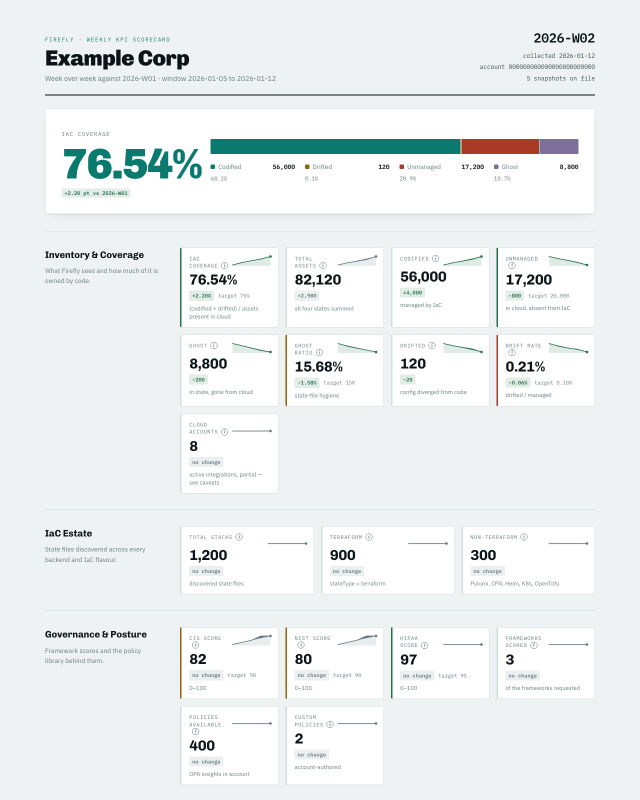

# Firefly weekly KPI scorecard

Collects a weekly snapshot of one Firefly account's health and turns the history into a scorecard:
IaC coverage, drift, ghost assets, posture scores, guardrails, workspaces and adoption, each with
week-over-week change, a trend line and a status against your own targets.



*The scorecard, built from the synthetic data in `examples/demo-home`. Each tile shows the value, change since the last week with data, a trend line and your target; the info icon on a tile explains the metric. The full page continues with a watchlist, who is using the platform, and measurement caveats.*

You get, after every run:

| File (in `data/reports/`) | Use |
|---|---|
| `firefly-kpi-scorecard.html` | the scorecard. Self-contained; open it in a browser or send it as a file |
| `kpi-metrics.md` | the same numbers as Markdown, for a wiki, ticket or chat |
| `kpi-metrics.csv` / `.json` | spreadsheets, decks, anything downstream |

One checkout tracks **one Firefly account**. To track a second account, clone the repo again.

## How it works

1. **Collect.** Claude Code runs the `/firefly-weekly-kpi` skill, which makes about 15 read-only
   calls to the Firefly API (through the Firefly MCP server) and writes `data/snapshots/<ISO-week>.json`.
2. **Validate.** `scripts/validate_snapshot.py` checks the snapshot (see Safeguards).
3. **Build.** `scripts/build_report.py` and `scripts/export_metrics.py` read every snapshot and write
   the reports. Pure Python, no dependencies. Both share one `derive()` function, so the HTML, CSV,
   JSON and Markdown cannot disagree.

KPI definitions and data-source notes are in [`KPI-FRAMEWORK.md`](KPI-FRAMEWORK.md).

## Requirements

- **Claude Code** (the `claude` CLI), signed in. Collection is done by Claude following the skill, so
  this is required for the weekly run. (Building reports from existing snapshots needs only Python.)
- **Python 3.8+**. No packages to install.
- **Firefly API keys**: an access key and a secret key, created in the Firefly web console under Settings > Users > Create Key Pair (the secret is shown only once). Read access is enough. Your **Firefly account ID** is needed only if you run this against several accounts.
- macOS or Linux. Setup can install a weekly schedule on macOS; Linux uses a cron line it prints.

## Quick start

```bash
git clone https://github.com/Firefly-SE/firefly-kpi-scorecard.git ~/code/firefly-kpi-scorecard
cd ~/code/firefly-kpi-scorecard

# Optional: see what a report looks like first, using synthetic data
KPI_HOME=examples/demo-home python3 scripts/build_report.py
# then open examples/demo-home/reports/firefly-kpi-scorecard.html

python3 setup.py        # guided configuration, about two minutes
claude                  # start Claude Code in this folder; approve the Firefly MCP server when asked
> /firefly-weekly-kpi   # first collection, takes a few minutes
```

Then open `data/reports/firefly-kpi-scorecard.html`.

> Clone somewhere **outside** Google Drive, Documents, Desktop and Downloads (for example `~/code`).
> macOS blocks scheduled jobs from reading those folders, and they fail silently.

## What `setup.py` asks

| Prompt | Notes |
|---|---|
| Account name | shown at the top of the report |
| More than one account? | answer no if this install is for your own Firefly account. Answer yes (SEs, consultants) to enter the account ID, shown in Firefly under Integrations > Connected integrations; snapshots from any other account are then refused |
| MCP server name | default `firefly`; the name Claude Code uses for the Firefly connection |
| Access key / secret key | secret is hidden; stored only in `.mcp.json` (mode 600, gitignored). Setup tests the keys against the API and says if they are rejected |
| Providers | which of AWS, Azure, GCP, Kubernetes to count integrations for |
| Uses Runners? | answer no to hide the Runner workspaces KPI |
| Targets | suggested defaults, none, or set each one. Counts that depend on estate size (unmanaged, drifted, workspaces) are never defaulted |
| Copy folder | optional: also copy each scorecard, timestamped, into a shared folder |
| Weekly schedule | optional, macOS: day and hour for an automatic run |

Re-run `python3 setup.py` any time. Existing answers are offered as defaults and nothing is deleted.

**Unattended setup** (for scripting): `python3 setup.py --answers answers.json` with keys
`account_name`, `account_id`, `access_key`, `secret_key`, `mcp_server`, `targets_mode` (1/2/3),
`provider_aws`, `provider_azurerm`, `provider_gcp`, `provider_k8s`, `runner_enabled`, `copy_to`,
`schedule`. `--skip-check` skips the credential test.

## Weekly use

**By hand:** run `claude` in this folder and type `/firefly-weekly-kpi`. Running it twice in one week
replaces that week's snapshot; earlier weeks are never touched.

**Automatically:** `./scripts/weekly-run.sh` does the whole loop headlessly (wait for network, collect,
validate, rebuild, copy, desktop notification) and exits non-zero if no snapshot was written. Setup
can schedule it with launchd on macOS. On Linux:

```
0 7 * * 1  KPI_HOME=/path/to/firefly-kpi-scorecard/data /bin/bash /path/to/firefly-kpi-scorecard/scripts/weekly-run.sh
```

The Mac or server must be awake at some point that day. launchd runs a missed job on wake; cron does not.

Manage a macOS schedule (label is printed by setup, `ai.firefly.kpi.<account>`):

```bash
launchctl list | grep firefly.kpi
launchctl kickstart -p gui/$(id -u)/<label>      # run it now
launchctl bootout   gui/$(id -u)/<label>         # disable
```

**Rebuild without collecting** (after hand-correcting a snapshot):

```bash
python3 scripts/build_report.py
python3 scripts/export_metrics.py            # all weeks; or: export_metrics.py W34 W35
```

## Configuration

Everything per-account lives in `data/` (gitignored). Set `KPI_HOME=/some/dir` to use another location.

| File | What it holds |
|---|---|
| `data/config.json` | account name and ID, MCP server name, providers, Runner on/off, `hidden_metrics`, `copy_to`, schedule |
| `data/targets.json` | `{"coverage_pct": 75, ...}`. Remove a key for "no target". Keys are listed in `KPI-FRAMEWORK.md` and `scripts/build_report.py` |
| `data/caveats.md` | every line starting with `- ` is shown under "Measurement caveats" in every report |
| `data/snapshots/` | one JSON per ISO week. Shape: `templates/snapshot.template.json` |

A snapshot's top-level `notes` field is the place to explain an unexplained swing; it is rendered as a
caveat on that week's report.

## Safeguards

These exist because a wrong number on a scorecard does more harm than a missing one.

- **"No data", never 0.** A metric that failed to collect is `null` and renders as "no data". It is
  never zero and never carried forward from last week.
- **One account per install.** Builders refuse to run if a snapshot's `account_id` differs from
  `config.json` (or, with no ID configured, if snapshots disagree with each other), so deltas can't mix accounts.
- **Validation.** `scripts/validate_snapshot.py` rejects missing fields and wrong account IDs, and warns
  on a suspicious zero or on workspace counts that fall by more than half week-over-week. A big drop
  more often means the API key can only see part of the project tree than that workspaces vanished.
- **Targets are yours.** Status colours are computed against `data/targets.json` only.

## Troubleshooting

| Symptom | Likely cause and fix |
|---|---|
| Claude says no Firefly tools are available | The project MCP server isn't approved. Run `claude` interactively in this folder once and approve it; check `.mcp.json` exists |
| Setup says the keys were rejected | Wrong key pair, or keys without access. Create a new pair in Firefly and re-run setup |
| Runner or CI workspaces read far lower than expected | The collecting key isn't a member of the projects holding them. Use a key with access to the whole tree |
| A provider reads "no data" | Its integrations call failed (timeouts happen). It is recorded as null on purpose; see the snapshot's `integrations.notes` |
| Scheduled run never produces a snapshot | Repo is inside Google Drive/Documents/Desktop (macOS blocks launchd), or `claude` isn't on launchd's PATH. See `data/logs/launchd.err.log` and the week's log |
| `snapshot(s) ... are not for account_id` | Snapshots from another account are in `data/snapshots/`. Move them out |

Logs: `data/logs/<ISO-week>.log` for each run.

## Security

- `.mcp.json` holds live API keys. It is gitignored and written mode 600. Don't paste it anywhere, and
  re-check `git status` before any push.
- `data/` contains your account's usage data (including user email addresses from the adoption section).
  It is gitignored. If you remove that ignore to keep snapshot history in git, use a private repo.
- Collection is **read-only**: the skill only calls list/search/get endpoints.

## Layout

```
setup.py                       guided configuration
KPI-FRAMEWORK.md               KPI definitions (source of truth)
.claude/skills/firefly-weekly-kpi/SKILL.md   the collection skill
scripts/build_report.py        HTML scorecard + shared derivation
scripts/export_metrics.py      CSV / JSON / Markdown
scripts/validate_snapshot.py   snapshot sanity checks
scripts/weekly-run.sh          unattended runner
scripts/copy-scorecard.sh      optional copy to a shared folder
templates/snapshot.template.json
examples/demo-home/            synthetic data to preview a report
tests/                         python3 -m unittest discover tests
data/                          your account's config, snapshots, reports, logs (gitignored)
```

## Tests

```bash
python3 -m unittest discover tests
```

Covers the report build, target and hidden-metric handling, the cross-account guard, the validator,
setup's unattended mode, and a check that no account-specific strings have crept into the code.

## License

MIT. See [LICENSE](LICENSE).
